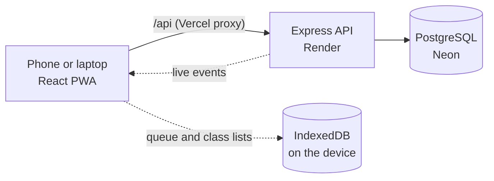

# Sutra

**One student. One record.**

A college ERP for attendance, internal marks and fee dues. It is my take-home for the Isocode Labs Software Engineering Intern role (brief 3, the multi-campus college ERP), and I built it as a project I'd be proud to keep.

**Live app:** https://sutra-azure.vercel.app
**Demo logins, a five-minute tour and run steps:** [deployment.md](./deployment.md)

---

## Hi, I'm Manvith

The brief describes three colleges running on paper, Excel and a desktop program nobody can fix. I built the first slice for one campus and put my effort into the two things that are hardest to get right in a real college:

- **Attendance a teacher can take with no signal,** that can never be counted twice when it syncs.
- **Marks that cannot change without a trace,** from the first entry to the exam audit.

Everything else (fees, risk flags, guardian consent, plain-English questions) is built around making those two solid.

---

## What it does

**Faculty, on a phone**
- Take attendance in seconds: everyone starts as Present, tap only the absentees.
- Works offline. Marks are saved on the device first and sync when the signal returns.
- Enter internal marks by component, with instant validation, and submit them for moderation.
- See their mentees and what to do about them.

**Office admin, on a desk**
- Moderate marks as a recorded adjustment with a reason, lock the sheet, export it, and approve or reject unlock requests.
- A fee ledger per student: scholarships, payments, receipts, payment links and an accounts export.
- A campus dashboard, parent alerts in English and Odia, guardian consent for minors, and a plain-English question box.

**Guardians**
- Open a payment link, with no sign-in, and get a receipt.

---

## Things I'm proud of

| | |
|---|---|
| **Idempotent offline sync** | The phone makes a UUID for every session. The server classifies each one as created, duplicate, updated or conflict, and a unique key on class, date and period stops double counting even in a race. |
| **A moderation lock the database enforces** | One rule table decides who can move a sheet from where to where. The audit log is append-only, and a Postgres trigger rejects any UPDATE or DELETE on it. |
| **A fee ledger that cannot drift** | Charges, payments and scholarships are only ever added, never edited. Dues are worked out each time, money is in paise, payments are idempotent, and receipt numbers come from a database sequence. |
| **Explainable at-risk flags** | Fixed rules with points, so every flag says exactly why. It can only create a mentor task. |
| **Ask Sutra, read-only by design** | An AI model (or a rule parser as fallback) turns a question into a small structured query. My own code validates and runs it, and the screen shows the filters used and the row count. No SQL is ever generated. |
| **Guardian consent (DPDP)** | Messages to a minor's guardian are held until consent is recorded, then released. Consent and withdrawal are both on record. |
| **Live screens** | When the office changes something, the faculty screen updates without a refresh. |
| **Measured, not guessed** | I load-tested with about 7,000 extra students, found where it broke, and fixed it. The numbers are in the design document. |

---

## How it fits together



- **Client:** React and Vite, installed as a PWA. Self-hosted font, so the app shell loads with no network.
- **Server:** Node, Express and Prisma on PostgreSQL. Business rules are small pure functions in `server/src/lib`, so they are easy to test.
- **Auth:** an httpOnly, secure cookie. Roles are faculty and office admin, and every query is scoped to the campus in the signed token.

---

## Tech

React, Vite, `vite-plugin-pwa`, IndexedDB (`idb`) · Node.js, Express, Prisma, PostgreSQL (Neon) · Zod, bcrypt, JWT cookies, Helmet, rate limiting, `node-cron`, server-sent events · Vitest · Vercel and Render.

---

## Run it

The quick version is below. The full steps, with every environment variable, are in [deployment.md](./deployment.md).

```bash
git clone https://github.com/manvithknm54/Sutra.git
cd Sutra/server && npm install && cp .env.example .env   # fill in the values
npx prisma migrate deploy && npm run seed && npm run dev

# second terminal
cd Sutra/client && npm install && echo VITE_DEMO=true > .env.local && npm run dev
```

Open http://localhost:5173. Demo accounts: `admin@sutra.demo` and `sanjay@sutra.demo`, password `Sutra@2026`.

**Tests:** `cd server && npm test`

---

## Project layout

```
client/                  React app
  src/pages/             one file per screen
  src/components/        shell, dialogs, shared UI
  src/lib/offline.js     IndexedDB queue and sync engine
  src/lib/live.js        live-update channel
server/
  src/routes/            thin routes: auth, validation, database work
  src/lib/               pure rules: attendance, marks, fees, risk, assistant
  prisma/                schema, migrations, seed scripts
  tests/                 unit tests for the rules
docs/design/             the Google Stitch screens I used as a visual reference
```

---

## What I left out, and why

I would rather show fewer things that work than many that only look good. I did not build admissions, staff leave, the calendar master, multi-campus switching, or the AICTE and NAAC report formats. Payments and messages are simulated, as the brief allows. The offline mode covers attendance only. The full list, with my reasons and what I would do next, is in the technical design document.

---

## A few honest notes

- The at-risk flag is **rules, not machine learning**. The brief calls attendance and marks rules fixed settings, and I have no real labelled history to train on. I chose something I can explain number by number.
- All data is **synthetic**. There is no real student or guardian information anywhere in this repository.
- The Odia message text still needs review by a native speaker.
- I used AI tools while building this, as the brief encourages, and I can explain every decision in it.

Thanks for taking the time to look at Sutra.

**Manvith Kumar N M** · [GitHub](https://github.com/manvithknm54) · [LinkedIn](https://linkedin.com/in/manvith-kumar-n-m) · manvithknm54@gmail.com
